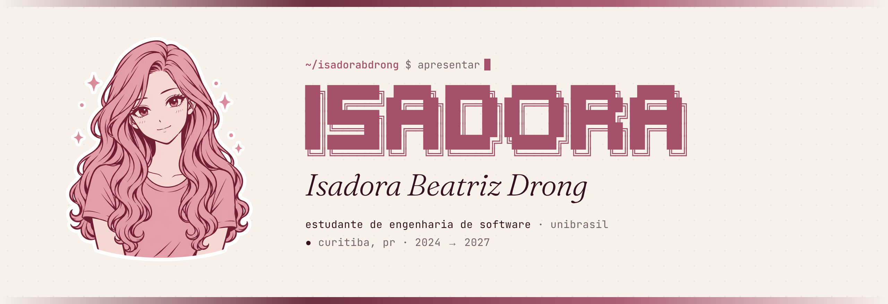
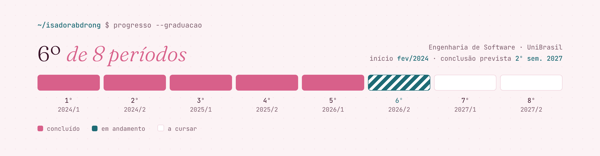

<picture>
  <source media="(prefers-color-scheme: dark)" srcset="assets/cabecalho-dark.png" />
  
</picture>

<p>
  <a href="https://www.linkedin.com/in/isadora-drong/"></a>
  <a href="mailto:isadorabeatrizdrong19@gmail.com"></a>
  
  
</p>

### `> sobre mim`

Estudante de Engenharia de Software na UniBrasil, em Curitiba, com conclusão prevista para o 2º semestre de 2027. Na graduação programo em Python, JavaScript, PHP, C, C++ e C#, desenvolvo aplicações web e mobile e modelo bancos relacionais (MySQL, SQL Server) e não relacionais (MongoDB).

Uso este GitHub para publicar projetos com código, documentação e instruções de execução — para que dê para clonar, rodar e entender as decisões técnicas.

```js
const isadora = {
  curso: "Engenharia de Software",
  instituicao: "UniBrasil",
  periodo: { inicio: "fev/2024", conclusaoPrevista: "2º semestre de 2027" },
  local: "Curitiba, PR",

  linguagens: ["Python", "JavaScript", "PHP", "C", "C++", "C#"],
  bancosDeDados: ["MySQL", "SQL Server", "MongoDB"],
  estudandoAgora: ["FastAPI", "testes automatizados em Python"],

  interesses: [
    "desenvolvimento de software", "engenharia de sistemas", "bancos de dados",
    "inteligência artificial", "dados", "infraestrutura", "segurança",
  ],
};
```

### `> graduação`

<picture>
  <source media="(prefers-color-scheme: dark)" srcset="assets/graduacao-dark.png" />
  
</picture>

Disciplinas presentes nos meus trabalhos: programação orientada a objetos, banco de dados, qualidade de software e testes, gerência de projetos, desenvolvimento de aplicativos, interação humano-computador e inteligência artificial.

### `> tecnologias`

<picture>
  <source media="(prefers-color-scheme: dark)" srcset="assets/tecnologias-dark.png" />
  
</picture>

**Conceitos:** programação orientada a objetos · lógica de programação · modelagem e manipulação de bancos de dados

### `> atividade no github`

<p align="center">
<picture>
  <source media="(prefers-color-scheme: dark)" srcset="https://streak-stats.demolab.com/?user=Isadorabdrong&locale=pt_BR&hide_border=true&border_radius=10&background=1B0D17&ring=F2A7BF&fire=3B9AA5&currStreakNum=FBEFF3&sideNums=F2A7BF&currStreakLabel=3B9AA5&sideLabels=FBEFF3&dates=B49AA8&stroke=43213A" />
  
</picture>
</p>

<picture>
  <source media="(prefers-color-scheme: dark)" srcset="https://github-readme-activity-graph.vercel.app/graph?username=Isadorabdrong&bg_color=1B0D17&color=FBEFF3&line=F2A7BF&point=3B9AA5&area=true&area_color=F2A7BF&hide_border=true&radius=10&title_color=3B9AA5&custom_title=Contribui%C3%A7%C3%B5es%20nos%20%C3%BAltimos%2031%20dias" />
  
</picture>

### `> próximos passos`

```text
[ ] publicar projetos acadêmicos e pessoais com código executável, README e testes
[ ] consolidar FastAPI e testes automatizados em Python
[ ] atuar profissionalmente em tecnologia (estágio ou vaga júnior) durante a graduação
```

### `> contato`

[LinkedIn](https://www.linkedin.com/in/isadora-drong/) · [isadorabeatrizdrong19@gmail.com](mailto:isadorabeatrizdrong19@gmail.com)

<picture>
  <source media="(prefers-color-scheme: dark)" srcset="assets/rodape-dark.png" />
  
</picture>
